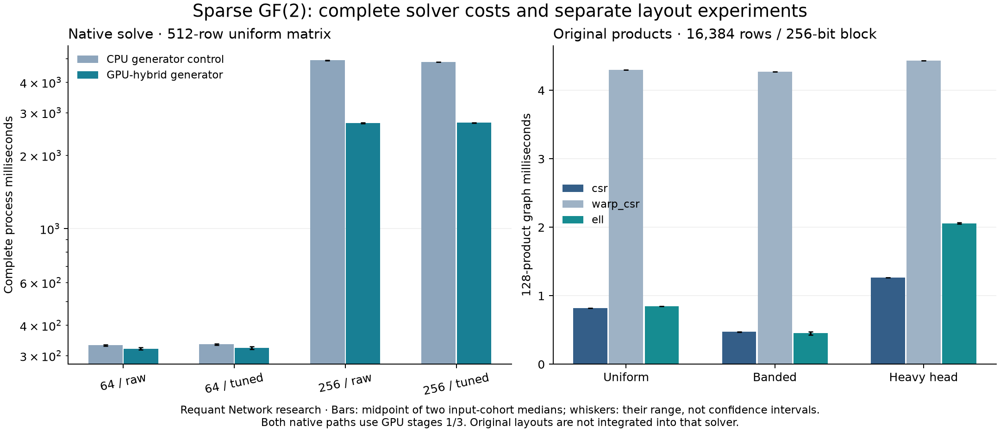

# Sparse GF(2) GPU Research

A research project by [Requant Network](https://requant.network).

**Status: the bounded research protocol is complete.** The corrected solver passes two 48-case oracle campaigns and 720 timed solve observations. Complete [results](RESULTS.md), [methods](METHODS.md) and [final conclusions](FINAL_REPORT.md) retain the backend and workload boundaries.

This project studies exact sparse binary linear algebra on consumer Blackwell: complete Block Wiedemann solves and repeated sparse matrix-block products. Its relevance is to the linear-algebra stage of factoring and other cryptographic computations. It does not implement a complete factorization pipeline or demonstrate a profitable proof-of-work scheme.

## Findings so far

| Experiment | Observed result |
|---|---|
| CPU elimination and certificates | 72 exhaustively checked small nullspaces; six seeded sparse families; 52 altered certificates rejected |
| Unmodified pinned native golden solve | Fails its own stage-three oracle comparison |
| Independent diagnosis | One faulty batched reconstruction has a nonzero residual, so the discrepancy is a mathematical error rather than only a different vector hash |
| Attributed two-part correction | Group batch candidates by polynomial degree; clear unwritten stripping history |
| Corrected upstream golden test | Completes with all native oracle and annihilation checks enabled |
| Independent controlled solve | Five nonzero, linearly independent vectors satisfy `A*x = 0` under a separate CPU implementation |
| Native compatibility campaigns | All 48 parameter combinations pass separately with the CPU generator and explicitly selected GPU-hybrid generator, with native oracles enabled |
| Original sparse products | CSR, warp-CSR and ELL pass 128 actual Krylov applications at two sizes and three families, in two input cohorts |
| Complete solver timings | 96 backend/parameter cases, 720 retained observations; all exported certificates pass independent CPU checks |

Comparative timing starts after heavy CUDA compilation ends, and GPU jobs run sequentially. Earlier preflight times are compatibility observations, not performance comparisons.

## Main findings

The pinned library defaults its generator to CPU mode. The initial harness inherited that setting; its data are retained as a labelled control. The separately selected GPU-hybrid path roughly halves the block-256 generator cost in the uniform 512-row case, while the complete solve remains much slower than block 64. This is a parameter/backend tradeoff, not a sparse-kernel throughput result.

Original CSR is the most consistent product layout in these workloads. A small ELL win on one banded input is not replicated by the other cohort and loses after conversion. Warp-per-output CSR is slower in the tested degree distributions. The original layouts remain separate from the upstream solver, and the report uses a conservative full-solve ceiling instead of inventing an integrated speedup.



## Why the reconstruction failed

The original batched Horner loop advanced every candidate to the batch's maximum polynomial degree. A candidate with a smaller degree could therefore receive extra applications of the operator after its own polynomial ended. Its degree-local oracle check could pass, even though the value later supplied to stripping was different or already zero.

The stripping history was allocated without initialization. An early backward scan could inspect unwritten slots, resurrecting an initially zero candidate as arbitrary data. Independent residual checking exposed a vector with 256 nonzero residual entries. Both causes are addressed in [patches/batch-reconstruction.patch](patches/batch-reconstruction.patch); no oracle or arithmetic check is disabled.

The patch is over upstream Block Wiedemann commit `ebfe814b759803f61771b36d1fd197b71b751d1d`. Upstream sources remain immutable. [build_native.py](build_native.py) copies and patches the single reconstruction source, compiles a replacement object, and removes the original object from a copied static archive to avoid duplicate CUDA device definitions. Other native objects remain those of the pinned build.

## Independent mathematics and workload scope

[experiments/binary.py](experiments/binary.py) implements GF(2) elimination with Python bit integers, exhaustive small-kernel checks, sparse XOR products, and nonzero certificate validation. The controlled matrix generator has uniform, banded, and heavy-head row patterns. It deliberately duplicates eight columns to guarantee a nontrivial kernel. These fixtures study controlled algebra and irregular memory access; planted kernel vectors do not establish cryptographic hardness.

The native harness explicitly solves the **right kernel of A**, exports every solution, and checks its residual. The Python checker independently verifies the residuals and linear independence. Distinct vectors alone are insufficient. Failures are retained rather than silently removed from timing populations.

Original CSR, warp-per-output CSR, and ELL products are compared over 128 actual Krylov applications with 256-bit blocks. Their outputs are checked against Python integer XOR arithmetic. These original kernels are separate from the upstream solver; a product-kernel win cannot be reported as a measured end-to-end solver speedup.

## Reproduction

CPU controls need Python 3.12:

```sh
python cpu_study.py
python verify_records.py
python verify_results.py
```

Build the pinned upstream with CUDA 13.3, `GPU_TARGET=120`, Release configuration and CUDA graphs enabled. Keep the checkout clean. From this repository:

```sh
python build_native.py ../block-wiedemann ../bw-build
python native_preflight.py
python build_timing.py ../block-wiedemann ../bw-build
python build_gpu_timing.py ../block-wiedemann ../bw-build
python native_study.py --stage2 cpu --validation-only --output results/native-validation.json
python native_study.py --stage2 gpu --validation-only --output results/native-gpu-validation.json
```

For performance, omit `--validation-only`, retain the explicit `--stage2` selector, and use output `results/native-study.json` for the CPU control or `results/native-gpu-study.json` for the GPU-hybrid path. Uniform 512-row configurations use five warmups/thirty process observations. Larger and irregular solves use one warmup/three observations. Generator seeds `20261109` and `20261209` are distinct from repeated timing observations. Process wall time includes input reading, setup, tuning, all three stages, native checking, and writing certificates; native phase timers and Python verification are separate. Both paths retain GPU stages 1/3 and GPU annihilation checking; the selector concerns the generator backend.

With NumPy 2.2.6 and CuPy 13.6.0, run the original layouts with `python gpu_study.py`; use `--validation-only` for correctness probes. Store the timed outputs as `results/gpu-study-20261109.json` and `results/gpu-study-20261209.json`, repeating with `--seed 20261209`. Resident direct/captured timing includes 128 actual products; layout conversion and vector transfers are separate. Generate the derived tables and reports with `python summarize_results.py` and `python generate_report.py`. No energy claim is made.

## Evidence, limits and licensing

The [protocol](RESEARCH.md) defines completion gates. Raw records are retained in [results](results), including complete native vectors suitable for CPU-only checking. CI reruns independent CPU arithmetic, checks source bindings, and independently checks committed native certificates; hosted CPU CI does not rerun CUDA solves.

The [final report](FINAL_REPORT.md) maps the protocol gates to retained evidence, including the original failing vectors and all CPU/GPU-hybrid backend measurements. [Related work](RELATED_WORK.md) separates the established algorithms from this study's correction and experiments. The reconstruction correction is tested on bounded fixtures and the upstream golden test; it is not a general proof of solver correctness. Original research code is [MIT licensed](LICENSE). The attributed patch and included upstream material retain LGPL-3.0-only and the upstream NVIDIA CUDA linking exception. No issue or pull request has been sent upstream.
