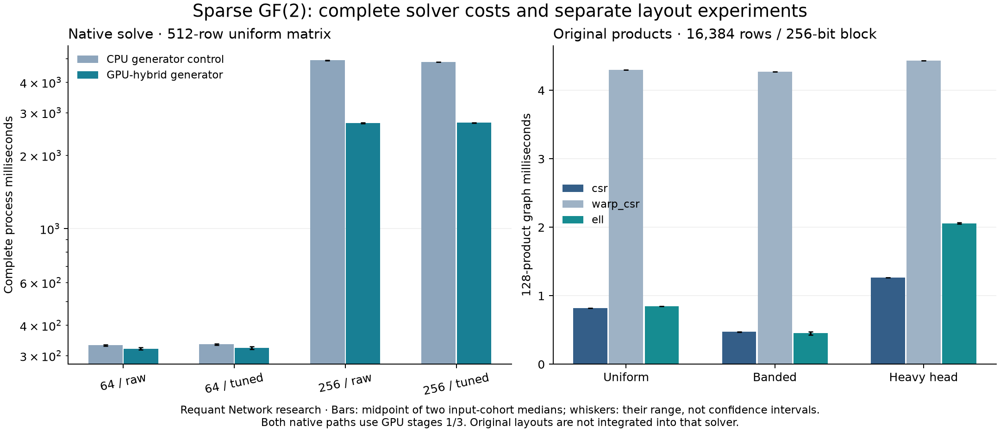

# Results

A research project by [Requant Network](https://requant.network).

## Correctness and complete solver coverage

The corrected native solver completes 720 timed fresh-process observations across 96 parameter cases: two generator backends, two input seeds, three matrix families, dimensions 512/2048, blocks 64/256 and tuning off/on. All observations return nonzero certificates that pass independent CPU residual and linear-independence checks. The requested output is at most five certificates, not the entire nullspace basis.

Separate compatibility campaigns contain 48 CPU-generator and 48 GPU-hybrid-generator cases with all native oracles enabled. All 96 pass. The upstream golden run also passes with its GPU generator and original checks enabled. Independent small CPU tests retain 72 exhaustively checked nullspaces, six sparse families and 52 targeted invalid-certificate rejections.

The original unmodified golden solve fails an oracle comparison. The retained [diagnostic vectors](results/reconstruction-failure.json) establish a real mathematical error: the batched vector has residual weight 256 while the scalar reference has zero residual under the same deterministic matrix. The two-part correction groups equal-degree Horner candidates and initializes stripping history. No oracle is removed.

## Generator and block choice: uniform 512-row case

Each interval spans the two input-cohort medians and is not a confidence interval. These cases use five warmups and thirty retained observations. Process time includes launch, input reading, initialization, tuning, all stages, native checking and certificate writing. Python certificate checking is separate. Native STATS logging is enabled in both timing executables.

| Generator path | Block | Tuning | Complete process median, ms | Stage 2 median, ms |
|---|---:|---|---:|---:|
| CPU control | 64 | off | 329.54–333.18 | 29.68–30.23 |
| CPU control | 64 | on | 332.58–335.55 | 28.53–29.55 |
| CPU control | 256 | off | 4914.27–4941.43 | 4630.24–4633.19 |
| CPU control | 256 | on | 4845.48–4854.78 | 4538.95–4548.32 |
| GPU hybrid | 64 | off | 317.53–324.49 | 14.81–15.13 |
| GPU hybrid | 64 | on | 318.96–327.45 | 14.81–14.85 |
| GPU hybrid | 256 | off | 2714.35–2727.10 | 2412.40–2423.92 |
| GPU hybrid | 256 | on | 2721.73–2738.38 | 2414.82–2430.86 |

The pinned configuration defaults `stage2_gpu_mode` to false. The first harness inherited that setting, so its measurements are retained as an explicit CPU-generator control. The second harness selects the GPU-hybrid recursive path explicitly; GPU initialization and the configured CPU cross-check remain active. GPU annihilation verification alone would not select that backend. These paths are now labelled separately in every summary row and its provenance.

The GPU-hybrid generator reduces the large block's dense-generator cost substantially, but block 256 remains much slower than block 64 in this bounded example. A wider block cannot be ranked from sparse-product throughput alone. Native preprocessing can improve stage-one work while its own cost and fresh-process setup leave the complete latency nearly unchanged.

## Original layout experiment: 16,384 rows and 256-bit blocks

Every observation performs 128 actual dependent products, with outputs compared against independent Python integer XOR. Each fixed case has five warmups/thirty direct, graph and vector-transfer observations. The rows below describe a separate product workload, not an integrated solver substitution.

| Matrix family | Layout | 128-product graph median, ms | Conversion + graph median, ms | Layout bytes |
|---|---|---:|---:|---:|
| uniform | csr | 0.8214–0.8231 | 11.766–12.060 | 852,288–852,328 |
| uniform | warp_csr | 4.2973–4.2976 | 14.160–14.383 | 852,288–852,328 |
| uniform | ell | 0.8452–0.8470 | 20.345–20.740 | 851,968–851,968 |
| banded | csr | 0.4721–0.4773 | 9.527–9.700 | 789,712–790,232 |
| banded | warp_csr | 4.2727–4.2749 | 13.450–13.957 | 789,712–790,232 |
| banded | ell | 0.4279–0.4788 | 18.448–18.531 | 983,040–1,048,576 |
| head | csr | 1.2673–1.2680 | 15.127–15.329 | 1,024,448–1,024,460 |
| head | warp_csr | 4.4324–4.4325 | 17.588–18.664 | 1,024,448–1,024,460 |
| head | ell | 2.0482–2.0677 | 35.180–37.056 | 6,356,992–6,422,528 |

CSR is the most consistent baseline in these cases. Warp-per-output CSR is slower despite using more lanes per row. ELL has a small banded-family resident win in one cohort, while the other cohort does not reproduce that win; its conversion-inclusive result loses in both. The heavy-head family makes ELL padding costly in storage and runtime. This is useful negative evidence against treating a layout as universally superior.

Conversion-inclusive latency is one measured layout conversion/upload plus the graph median, not a separately sampled distribution. Vector-transfer-inclusive measurements are retained in [products-summary.csv](results/products-summary.csv). Original layouts are not integrated into the upstream solver, and no measured integrated-layout speedup is claimed.

## Full-solve bound and limits

For the GPU-hybrid 512-row/block-256/untuned case, even an optimistic bound that removes **all** of native phases 1 and 3 gives only 1.025–1.025× process speedup. Removing their sparse products alone can do no better. This is an Amdahl ceiling for that native workload, not an application of a kernel-speed ratio measured on a different matrix size.

The controlled matrices deliberately plant at least eight kernel dimensions through duplicated columns. They do not establish factoring-instance hardness. Fresh-process times include context/library setup and are not persistent-service latency. Larger/irregular solves use one warmup/three observations, rather than a thirty-sample distribution. Both backend data sets, exact settings, raw phase logs, failures and memory fields remain separate.

See [native-summary.csv](results/native-summary.csv), [Methods](METHODS.md), [related work](RELATED_WORK.md), [final conclusions](FINAL_REPORT.md) and the [protocol](RESEARCH.md). No complete factorization, mining-income or energy conclusion follows from these experiments.
